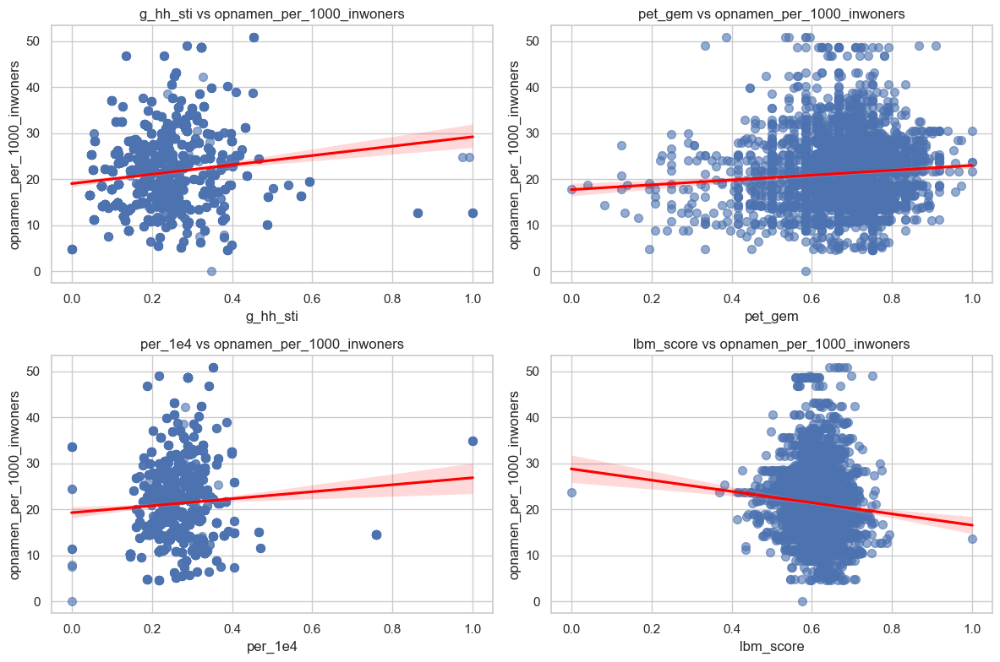
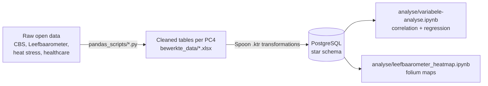
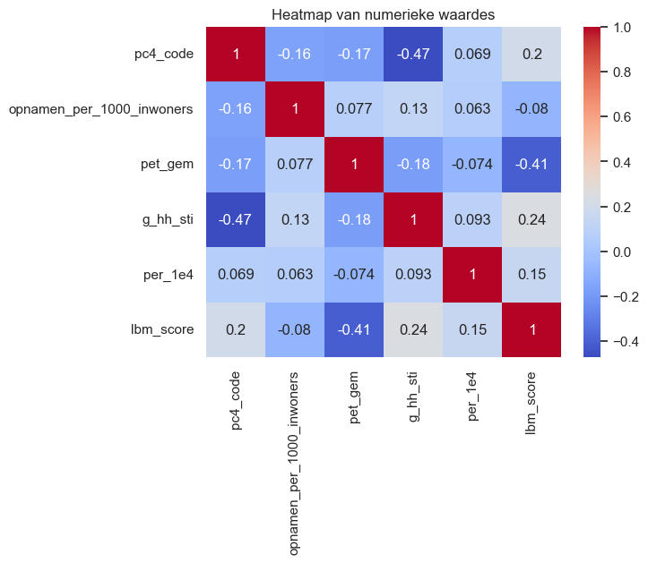

# INMINDAA Geboortezorg: regional factors and pregnancy outcomes in the Netherlands

An ETL pipeline and regression analysis that combines open Dutch government data (income, heat stress, liveability and access to healthcare) per postcode area to see how strongly these relate to pregnancy-related hospital admissions.

[](https://github.com/DanielB-02/inmindaa_geboortezorg/actions/workflows/ci.yml)

**Live demo:** [TODO: live demo link, e.g. one of the generated folium maps hosted on GitHub Pages]



[TODO: screenshot of an interactive folium heatmap, e.g. `leefbaarometer_heatmap.html` zoomed in on the Randstad]

## What it does and why

Built as a 4-person student team project for the Datalab at Hogeschool Rotterdam (2025). The research question: *do regional socio-economic and environmental factors relate to pregnancy outcomes?* We collected five public datasets, cleaned them and mapped them to 4-digit postcode areas (PC4) with pandas. We then loaded them into a PostgreSQL star schema with Pentaho Data Integration (Spoon) and analysed them in Jupyter with correlation and linear regression analysis plus interactive maps.

**My role:** [TODO: describe your own contribution, e.g. heat-stress and pregnancy pipelines, the `fact_rapportage` transformation, and the regression analysis notebook]

## Key features

- **Reusable cleaning helpers** (`pandas_scripts/excel_scripts.py`): filtering region levels, expanding municipality data to PC4, merges and column operations, all unit-tested
- **One script per dataset** that turns the raw Excel export into a clean, PC4-keyed table
- **Star schema in PostgreSQL**: one fact table (`fact_rapportage`) and six dimensions, loaded with Spoon transformations
- **Statistical analysis**: imputation of missing values from postcodes in the same region (same first two digits), min-max normalisation, correlation matrix, single- and multi-variable linear regression
- **Interactive choropleth maps** per variable with folium and geopandas

## Tech stack

Python · pandas · SQLAlchemy · PostgreSQL · Pentaho Data Integration (Spoon) · scikit-learn · matplotlib / seaborn · folium / geopandas · Jupyter · pytest · ruff · GitHub Actions

## How it works



| Folder | Contents |
|---|---|
| `data/` | Raw source datasets (Excel) |
| `pandas_scripts/` | Cleaning scripts per dataset and shared helpers (`excel_scripts.py`) |
| `bewerkte_data/` | Cleaned output, input for the Spoon transformations |
| `spoon_transformaties/` | Pentaho transformations that fill `dim_armoede`, `dim_hittestress`, `dim_leefbarometer`, `dim_huisartsen`, `dim_zwangerschappen`, `dim_locatie` and `fact_rapportage` |
| `analyse/` | Analysis notebooks (regression, maps) |
| `tests/` | Unit tests for the cleaning helpers |

**Variables analysed** (per PC4):

| Variable | Meaning | Source |
|---|---|---|
| `opnamen_per_1000_inwoners` (dependent) | Hospital admissions for pregnancy ending in miscarriage, women aged 20–45 | CBS StatLine, *Ziekenhuisopnamen; ISHMT en regio* |
| `g_hh_sti` | Average standardised household income (× €1,000) | CBS *Kerncijfers wijken en buurten 2022* |
| `pet_gem` | Average perceived temperature (heat stress) | [TODO: confirm source of `gevoelstemperatuurPC4_2022.xlsx`] |
| `per_1e4` | GP density per 10,000 inhabitants | [TODO: confirm source of the zorgaanbod dataset] |
| `lbm_score` | Liveability score | Leefbaarometer |

### Results

From the committed output of `analyse/variabele-analyse.ipynb`: every variable on its own explains less than 2% of the variance in admissions (R² between 0.004 and 0.017). All four together reach **R² = 0.039**. Income has the strongest correlation (r = 0.13). In this data, these regional factors are at most weakly associated with the outcome.



## Getting started

Requires Python 3.12+.

```bash
git clone https://github.com/DanielB-02/inmindaa_geboortezorg.git
cd inmindaa_geboortezorg
python -m venv .venv
source .venv/bin/activate        # Windows: .venv\Scripts\activate
pip install -r requirements-dev.txt
```

**Run the cleaning pipeline** (works from any directory; output goes to `bewerkte_data/`):

```bash
python pandas_scripts/locatie_script.py
python pandas_scripts/hittestress_excel.py
python pandas_scripts/leefbaarometer_script.py
python pandas_scripts/zorgaanbod_excel.py
python pandas_scripts/armoede_script.py
python pandas_scripts/armoede_lan_lon_transformatie.py
```

Two source files are too large or were not committed and must be downloaded first into `data/`:
- `Ziekenhuisopnamen__ISHMT_en_regio_13062025_145613.xlsx`, from CBS StatLine (*Ziekenhuisopnamen; ISHMT en regio*), needed by `zwangerschappen_excel.py`
- `georef-netherlands-postcode-pc4.csv`, PC4 polygons from OpenDataSoft (*georef-netherlands-postcode-pc4*), needed by `locatie_coords_geoshape_script.py` and the maps

**Load into PostgreSQL and run the notebooks.** The notebooks read from a PostgreSQL database filled by the Spoon transformations.

1. Copy `.env.example` to `.env` and fill in your database credentials. The notebooks load it with `python-dotenv`.
2. In Spoon, set the same values as Kettle variables (`DB_HOST`, `DB_NAME`, `DB_USER`, `DB_PASSWORD`), for example in `~/.kettle/kettle.properties`. Then run the transformations in `spoon_transformaties/`.
3. Start Jupyter **from the repository root** (`jupyter lab`) and open the notebooks in `analyse/`.

[TODO: add the SQL DDL for the `INMINDAA_project` schema so the database can be recreated from scratch]

## Tests

```bash
pytest          # unit tests for the cleaning helpers
ruff check .    # lint
```

CI runs both on every push and pull request (Python 3.12 and 3.13).

## What I learned / next steps

- **Granularity matters more than the model.** Several datasets are only available per municipality and were copied to every postcode in it. That inflates the number of data points without adding information; the vertical stripes in the scatterplots show it. A next step would be to analyse at municipality level, or to use a mixed-effects model.
- **Keep identifiers out of the statistics.** `pc4_code` ended up in the correlation matrix as if it were a numeric variable. Also, the source reports admissions *per 10,000* inhabitants while the column is named `per_1000`. Clear naming and a data dictionary up front would have prevented both.
- **Reproducibility is a feature.** Hardcoded paths, credentials in notebooks and a shared remote database made the project hard to rerun. Moving to environment variables, pinned dependencies, tests and CI made it runnable by others.
